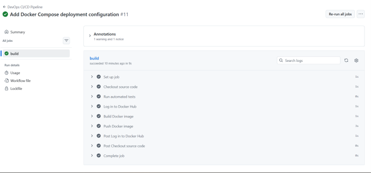
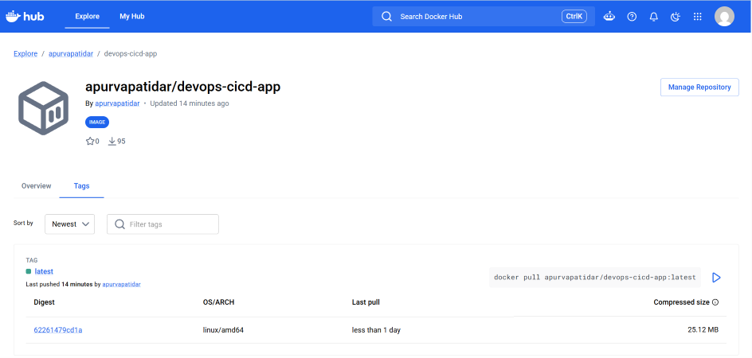
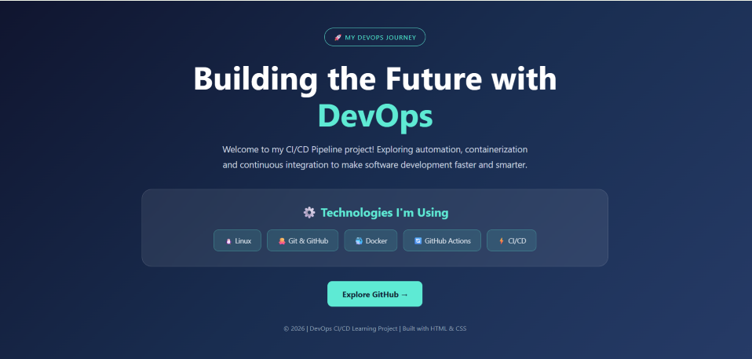
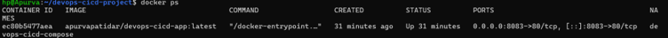

# DevOps CI/CD Pipeline using GitHub Actions and Docker

## 1. Project Overview

This project demonstrates an automated CI/CD pipeline using GitHub Actions and Docker.

Whenever code is pushed to the main branch, GitHub Actions automatically:
- Checks out the source code.
- Runs automated tests.
- Logs in to Docker Hub.
- Builds a Docker image.
- Pushes the image to Docker Hub.

The application is deployed using Docker Compose.

## 2. Technologies Used

- Git and GitHub
- GitHub Actions
- Docker
- Docker Hub
- Docker Compose
- Nginx
- Bash
- YAML
- HTML and CSS

## 3. Project Architecture

Developer
   |
   v
GitHub Repository
   |
   v
GitHub Actions Workflow
   |
   v
Automated Tests
   |
   v
Docker Hub Login
   |
   v
Docker Image Build
   |
   v
Push Image to Docker Hub
   |
   v
Docker Compose Deployment
   |
   v
Running Web Application

## 4. Project Structure

devops-cicd-project/
|
|-- .github/
|   |-- workflows/
|       |-- ci-cd.yml
|
|-- app/
|   |-- index.html
|
|-- Dockerfile
|-- docker-compose.yml
|-- test.sh
|-- README.md

## 5. CI/CD Pipeline

The GitHub Actions workflow is configured to run whenever code is pushed to the main branch.

Pipeline stages:

1. Checkout source code.
2. Execute automated tests.
3. Authenticate with Docker Hub using GitHub Secrets.
4. Build Docker image.
5. Push Docker image to Docker Hub.

## 6. Docker Hub Repository

Docker Hub Username: apurvapatidar

Image Name: devops-cicd-app

Docker Image:
apurvapatidar/devops-cicd-app:latest

Repository:
https://hub.docker.com/r/apurvapatidar/devops-cicd-app

## 7. Run the Application Locally

Clone the repository:

git clone https://github.com/apurva-patidar/Devops-cicd-pipeline.git

Navigate to the project:

cd Devops-cicd-pipeline

Build Docker image:

docker build -t devops-cicd-app .

Run the Docker container:

docker run -d -p 8082:80 --name devops-cicd-container devops-cicd-app

Open in browser:

http://localhost:8082

## 8. Run Using Docker Compose

Start the application:

docker compose up -d

Open in browser:

http://localhost:8083

Stop the application:

docker compose down

## 9. GitHub Secrets Configuration

The following repository secrets are required:

- DOCKERHUB_USERNAME
- DOCKERHUB_TOKEN

These secrets allow GitHub Actions to authenticate with Docker Hub securely.

Never store access tokens directly in source code.

## 10. Automated Testing

The test.sh script checks:
- Whether the application HTML file exists.
- Whether the expected website heading is present.

Run tests locally:

bash test.sh

## 11. Project Outcome

Successfully implemented an automated CI/CD pipeline that tests the application, builds a Docker image, publishes it to Docker Hub, and supports deployment using Docker Compose.

This project demonstrates practical knowledge of containerization, automation, CI/CD workflows, and deployment.

## 12. Author

GitHub: https://github.com/apurva-patidar

cat >> README.md <<'EOF'

## 13. Project Screenshots

### GitHub Actions - Successful CI/CD Pipeline

### Docker Hub - Published Docker Image

### Application Running

### Docker Compose - Running Container

